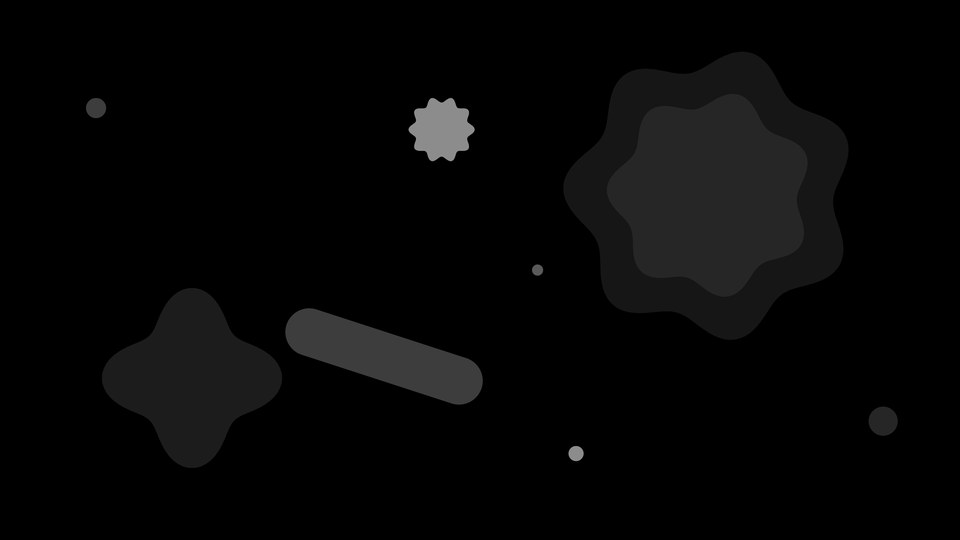

# blxshell themes

The official themes for [blxshell](https://github.com/binarylinuxx/dots).
Each one ships a wallpaper and generates its colours from it, so the shell
always matches the picture. Everything here is reviewed before it's merged.

| | Theme | |
|---|---|---|
|  | [Dune](themes/dev.blxshell.dune) | Dusk over the desert, warm sand and rose |
|  | [Tide](themes/dev.blxshell.tide) | A night sea under the moon, deep blue and teal |
|  | [Bloom](themes/dev.blxshell.bloom) | Material shapes in pinks on dark plum |
|  | [Graphite](themes/dev.blxshell.graphite) | Grey shapes on true black, for OLED screens |
|  | [Meadow](themes/dev.blxshell.meadow) | A light morning over green hills |

## Installing

Open **blxshell Store**, filter by **Themes** and press **Apply**, or:

```sh
blxshell install dev.blxshell.dune
blxshell theme apply dev.blxshell.dune
blxshell theme reset        # your own colours and wallpaper back
```

Every package is built in CI and published, with `index.json`, to the
[`packages` release](https://github.com/binarylinuxx/dots-themes/releases/tag/packages).
blxshell reads this repository next to
[dots-plugins](https://github.com/binarylinuxx/dots-plugins), so there's
nothing to add.

## Making a theme

A theme is a folder in `themes/` named after its id, with a `manifest.json`,
its `wallpaper.png` and a `preview.jpg`, listed in `list.json`. The manifest
format is in blxshell's
[docs/packages.md](https://github.com/binarylinuxx/dots/blob/main/docs/packages.md#themes);
`"wallpaper"` names the image and `"colours"` says how the palette is made:

```json
"wallpaper": "wallpaper.png",
"colours": { "kind": "generated", "source": "wallpaper", "scheme": "tonal-spot", "mode": "dark" }
```

The wallpapers here are drawn by `tools/wallpaper.py` (Pillow and numpy),
which also writes the previews:

```sh
python3 tools/wallpaper.py dune      # or no names for all of them
python3 tools/validate.py            # what CI checks
python3 tools/build.py --out build   # the .blx files and index.json
blxshell repo add ./build            # try them before pushing
```

A wallpaper you didn't draw needs a license that lets it be shared; say
which in the theme's manifest.
