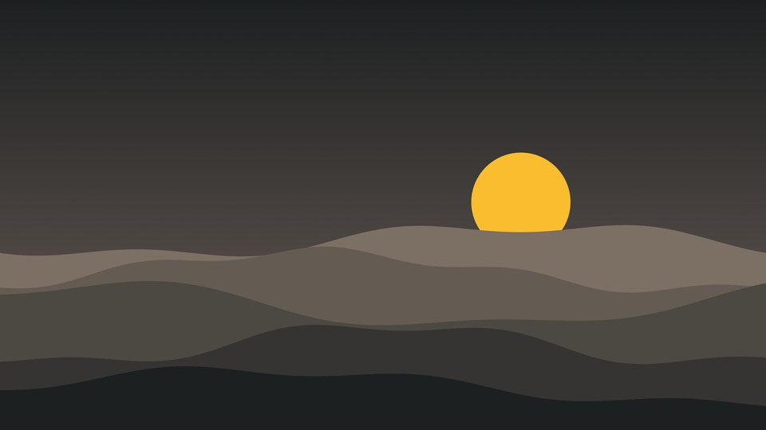
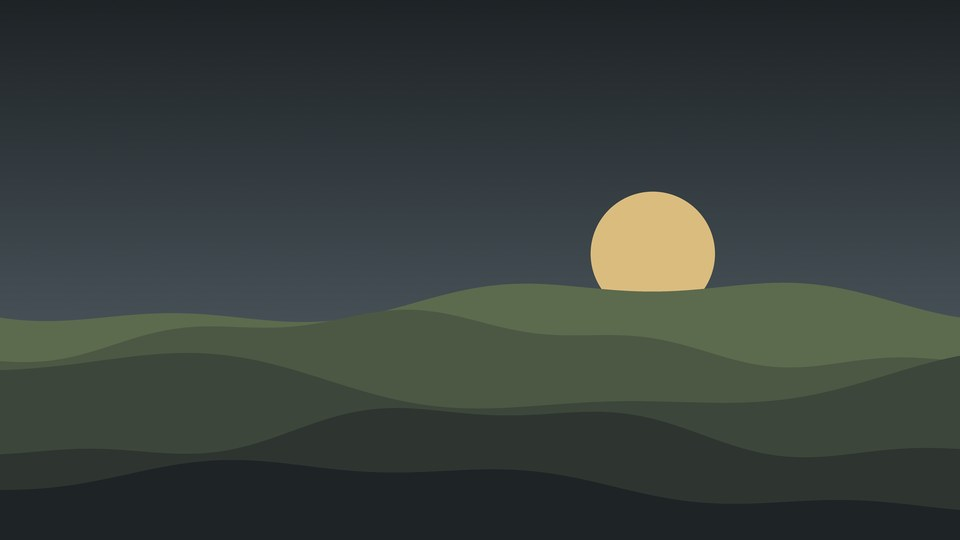
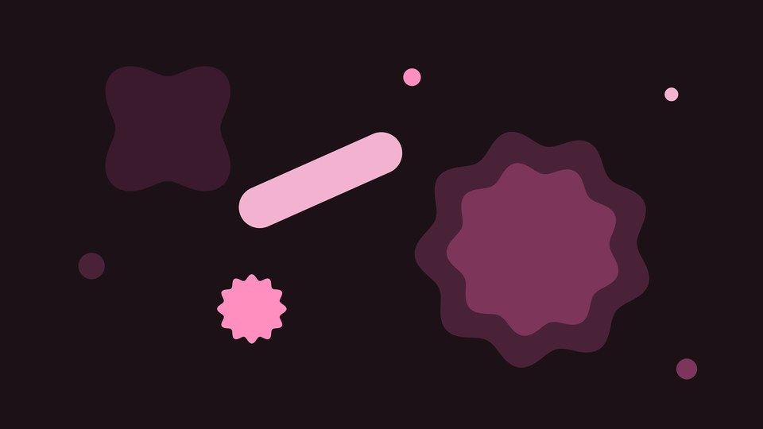

# blxshell themes

The official themes for [blxshell](https://github.com/binarylinuxx/dots).
Every one ships a wallpaper. Everything here is reviewed before it's merged.

## Colour schemes

Well-known schemes, every role fixed, for the whole shell and Ghostty. The
wallpaper is drawn in the scheme's palette, but the colours stay the same
whatever wallpaper you pick afterwards.

| | Theme | |
|---|---|---|
|  | [Catppuccin Mocha](themes/dev.blxshell.catppuccin-mocha) | dark; palette: Catppuccin (github.com/catppuccin) |
|  | [Catppuccin Latte](themes/dev.blxshell.catppuccin-latte) | light; palette: Catppuccin (github.com/catppuccin) |
|  | [Gruvbox](themes/dev.blxshell.gruvbox) | dark; palette: Gruvbox by Pavel Pertsev (github.com/morhetz/gruvbox) |
|  | [Nord](themes/dev.blxshell.nord) | dark; palette: Nord by Arctic Ice Studio (nordtheme.com) |
|  | [Tokyo Night](themes/dev.blxshell.tokyo-night) | dark; palette: Tokyo Night by enkia (github.com/enkia/tokyo-night-vscode-theme) |
|  | [Rosé Pine](themes/dev.blxshell.rose-pine) | dark; palette: Rosé Pine (rosepinetheme.com) |
|  | [Everforest](themes/dev.blxshell.everforest) | dark; palette: Everforest by sainnhe (github.com/sainnhe/everforest) |
|  | [Dracula](themes/dev.blxshell.dracula) | dark; palette: Dracula (draculatheme.com) |
|  | [Kanagawa](themes/dev.blxshell.kanagawa) | dark; palette: Kanagawa by rebelot (github.com/rebelot/kanagawa.nvim) |

## From the wallpaper

These generate their colours from their own wallpaper, Material You style.

| | Theme | |
|---|---|---|
|  | [Dune](themes/dev.blxshell.dune) | Dusk over the desert, warm sand and rose |
|  | [Tide](themes/dev.blxshell.tide) | A night sea under the moon, deep blue and teal |
|  | [Bloom](themes/dev.blxshell.bloom) | Material shapes in pinks on dark plum |
|  | [Graphite](themes/dev.blxshell.graphite) | Grey shapes on true black, for OLED screens |
|  | [Meadow](themes/dev.blxshell.meadow) | A light morning over green hills |

## Installing

Open **blxshell Store**, filter by **Themes** and press **Apply**, or:

```sh
blxshell install dev.blxshell.dune
blxshell theme apply dev.blxshell.dune
blxshell theme reset        # your own colours and wallpaper back
```

Every package is built in CI and published, with `index.json`, to the
[`packages` release](https://github.com/binarylinuxx/dots-themes/releases/tag/packages).
blxshell reads this repository next to
[dots-plugins](https://github.com/binarylinuxx/dots-plugins), so there's
nothing to add.

## Making a theme

A theme is a folder in `themes/` named after its id, with a `manifest.json`,
its `wallpaper.png` and a `preview.jpg`, listed in `list.json`. The manifest
format is in blxshell's
[docs/packages.md](https://github.com/binarylinuxx/dots/blob/main/docs/packages.md#themes);
`"wallpaper"` names the image and `"colours"` says how the palette is made:

```json
"wallpaper": "wallpaper.png",
"colours": { "kind": "generated", "source": "wallpaper", "scheme": "tonal-spot", "mode": "dark" }
```

A colour scheme is one entry in `tools/schemes.py`: its palette, mapped onto
the shell's 21 roles, and which wallpaper design to draw in it. The
wallpapers are drawn by `tools/wallpaper.py` (Pillow and numpy), which also
writes the previews:

```sh
python3 tools/schemes.py             # the scheme themes' manifests
python3 tools/wallpaper.py dune      # or no names for all of them
python3 tools/validate.py            # what CI checks
python3 tools/build.py --out build   # the .blx files and index.json
blxshell repo add ./build            # try them before pushing
```

A wallpaper you didn't draw needs a license that lets it be shared; say
which in the theme's manifest.
